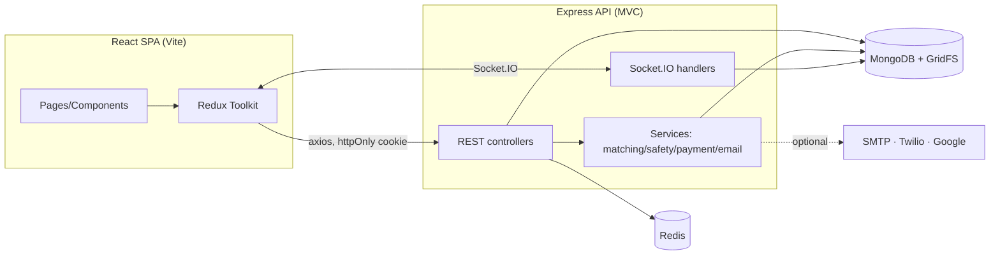

<div align="center">

# 🎓 CampusPool

### A verified, safety-first ride-sharing network for campuses

Share trips with **verified students and hosts** — safer commutes, fairer cost-sharing,
and a campus network you can actually trust. **Not ride-hailing. Not an Uber clone.**

React 19 · Redux Toolkit · Vite · Express · MongoDB · Socket.IO · JWT · Docker

[Project Overview](docs/PROJECT_OVERVIEW.md) ·
[Architecture & Diagrams](docs/ARCHITECTURE.md) ·
[Project Report](docs/PROJECT_REPORT.md) ·
[Presentation Guide](docs/PRESENTATION_GUIDE.md)

</div>

---

## Overview

CampusPool is a MERN platform where college students share rides between hostels, the
campus, metro stations, coaching centres and nearby cities. Only **college-verified**
students and hosts participate, trips are surfaced through an **intelligent
match-scoring engine** (not a flat list), and every trip ships with **safety tooling**
(SOS, live location, check-in, safe-arrival) and **peer-to-peer cost settlement**
(cash or direct UPI).

> A peer-to-peer campus **carpooling** network — with verification, cost-sharing,
> trust/reliability scoring, route-based matching and campus-aware safety. It uses
> the language of **Student · Host · Passenger · Campus · Trip · Verification** — never
> _driver, rider, surge, taxi_.

## Screenshots

| Sign in (light)                                       | Sign in (dark)                                      | Email verification                                      |
| ----------------------------------------------------- | --------------------------------------------------- | ------------------------------------------------------- |
|  |  |  |

| Trip controls (host)                                         | Trip in progress                                      | Trip completed                                    |
| ------------------------------------------------------------ | ----------------------------------------------------- | ------------------------------------------------- |
|  |  |  |

## Features

- **Auth & college binding** — JWT in an **httpOnly cookie**, a hard **email-verification
  gate** before login, **optional login 2FA** (email OTP), **password reset** (hashed
  single-use token), and **env-gated Google OAuth**. Email domains map to a `College`.
- **Verification** — college-email OTP (Nodemailer), Student/College ID uploads
  (multer → GridFS), host vehicle docs, admin approval queues, and trust badges.
- **Trips & lifecycle** — hosts offer carpool trips; students request → host approves;
  cost split per seat; carbon saved; host-controlled lifecycle **Offered → In progress
  → Completed** (with Start / Complete / Cancel controls on Trip Detail).
- **Intelligent matching** — ranked search + "For You" recommendations scored on route,
  timing, hostel/college, trust, host rating and seats; 10-minute recommendation cache;
  host reliability score.
- **Real-time** — Socket.IO trip chat, live trip location, typing indicators, and an
  admin operations feed — all authenticated from the httpOnly cookie.
- **Safety** — SOS to trip members + campus ops + emergency contacts (Twilio), en-route
  check-in, safe-arrival confirmation with **overdue escalation**, live location share,
  external share links, and member reporting.
- **Payments** — peer-to-peer settlement via **cash** or **direct UPI QR** to the host;
  host view of who has paid. No wallet, **no surge, no commission**.
- **Ratings & trust** — trip-scoped host↔passenger ratings feeding trust scores.
- **Notifications, legal & SEO** — in-app notifications, Privacy/Terms, cookie consent,
  per-route meta/OG/JSON-LD, robots/sitemap, support & bug-report flows, and
  consent-gated product analytics.
- **Brute-force protection** — per-account lockout, per-OTP attempt caps, and granular
  per-IP rate limiting (login / reset / OTP) backed by **Redis**.

## Tech stack

| Layer        | Technologies                                                                                       |
| ------------ | -------------------------------------------------------------------------------------------------- |
| Frontend     | React 19 · Redux Toolkit · React Router · Vite · Lucide · react-helmet-async                       |
| Backend      | Node.js · Express (MVC) · Mongoose                                                                 |
| Realtime     | Socket.IO                                                                                          |
| Data         | MongoDB (GridFS) · Redis (rate-limit store)                                                        |
| Security     | JWT (httpOnly cookie) · bcrypt · helmet · hpp · mongo-sanitize · express-rate-limit · Google OAuth |
| Integrations | Nodemailer (SMTP) · Twilio (SMS) · Google Maps                                                     |
| Testing      | Jest · Supertest · Puppeteer · mongodb-memory-server                                               |
| Tooling      | ESLint · Prettier · Docker / docker-compose · nginx                                                |

## Architecture summary



Three-tier MERN with a real-time layer: a Redux-driven React SPA talks to a **stateless**
Express API over JSON + an httpOnly auth cookie, and over WebSockets for chat/location/SOS.
MongoDB is the system of record; Redis backs distributed rate-limiting. Full diagrams
(auth, trip lifecycle, verification, matching, safety, payments, **ER**) are in
[`docs/ARCHITECTURE.md`](docs/ARCHITECTURE.md).

## Folder structure

```
.
├── client/                 # React 19 + Vite SPA
│   └── src/
│       ├── pages/          # Login, FindTrips, OfferTrip, TripDetail, Profile, …
│       ├── components/     # AppShell, TripCard, StatusPill, TripSafety, TripPayment
│       │   └── auth/       # AuthLayout, Field, OtpField, ResendButton, CampusRouteArt
│       ├── store/          # Redux Toolkit slices (auth, trips, chat, …)
│       ├── services/       # api (axios), socket, tracking
│       └── styles.css      # design tokens + components (light/dark)
├── server/                 # Express API (MVC)
│   └── src/
│       ├── routes/ controllers/ services/ models/ middleware/ sockets/ config/
│       └── seed.js         # one-command demo data
├── docs/                   # OVERVIEW · ARCHITECTURE · REPORT · PRESENTATION · screenshots
└── docker-compose.yml
```

## Quick start (local)

```bash
npm run install:all                 # root + server + client deps
cp .env.example server/.env         # set MONGO_URI, JWT_SECRET, (optional) SMTP_*
npm run seed --prefix server        # demo colleges, users, vehicles, trips
npm run dev                         # API :5000 + client :5173
```

Demo logins (password `password123`): `admin@univ.edu`, `aarav@univ.edu` (host),
`riya@univ.edu` (student).

> No MongoDB handy? Run the in-memory stack used for E2E:
> `node server/scripts/visual-server.mjs` (API + seed on `:5000`) +
> `npm run dev --prefix client`.

## Environment variables

Server (`server/.env`) — see [`.env.example`](.env.example) for the full list:

| Variable                                                  | Required  | Description                                                   |
| --------------------------------------------------------- | :-------: | ------------------------------------------------------------- |
| `MONGO_URI`                                               |    ✅     | MongoDB connection string                                     |
| `JWT_SECRET`                                              | ✅ (prod) | Auth-token secret; prod boot fails if missing/weak            |
| `CLIENT_URL`                                              |    ✅     | SPA origin for CORS + cookies (e.g. `http://localhost:5173`)  |
| `COOKIE_SAMESITE`                                         |     –     | `lax`/`strict` (same-site deploy). `none` is rejected in prod |
| `JWT_EXPIRES_IN`                                          |     –     | Token lifetime (default `7d`)                                 |
| `REDIS_URL`                                               |     –     | Rate-limit store (falls back to in-memory if absent)          |
| `AUTH/LOGIN/PASSWORD_RESET/OTP_*_RATE_LIMIT`              |     –     | Per-IP brute-force caps                                       |
| `SMTP_HOST/PORT/USER/PASS/FROM`                           |     –     | Email OTPs (dev surfaces `previewOtp` if unset)               |
| `SUPPORT_EMAIL`                                           |     –     | Inbox for support / bug reports                               |
| `GOOGLE_CLIENT_ID/SECRET/CALLBACK_URL`                    |     –     | Google OAuth (auto-enabled when set)                          |
| `TWILIO_ACCOUNT_SID/AUTH_TOKEN/FROM_NUMBER`               |     –     | SOS SMS (no-ops if unset)                                     |
| `ARRIVAL_GRACE_MINUTES` / `ARRIVAL_SCAN_INTERVAL_SECONDS` |     –     | Safe-arrival escalation tuning                                |
| `GOOGLE_MAPS_API_KEY`                                     |     –     | Server-side Maps (Directions/Geocoding)                       |

Client (build-time `VITE_*`): `VITE_API_URL`, `VITE_SOCKET_URL`,
`VITE_GOOGLE_MAPS_API_KEY`, `VITE_GOOGLE_OAUTH_ENABLED`, `VITE_GOOGLE_SITE_VERIFICATION`.

> All third-party integrations are **optional** and degrade gracefully when unset.

## How to test

```bash
npm test --prefix server            # Jest + Supertest, in-memory MongoDB — 101 tests / 20 suites
```

End-to-end (real UI + real API) — start the in-memory stack, then from `client/`:

```bash
node ../server/scripts/visual-server.mjs   # API + seed (:5000)
npm run dev                                 # SPA (:5173)
node scripts/e2e-full.mjs                   # full journey: register→…→complete (20/20)
node scripts/e2e-lifecycle.mjs              # host Start/Complete UI (6/6)
node scripts/shots-auth.mjs                 # responsive auth screenshots (light/dark)
```

## Run with Docker

```bash
cp .env.example .env                 # set JWT_SECRET (required), MONGO_PASSWORD, VITE_GOOGLE_MAPS_API_KEY
docker compose up --build            # web :8080, api :5000, mongo (internal)
docker compose exec api npm run seed
```

The compose stack provisions an authenticated MongoDB, injects `JWT_SECRET` (build fails
if unset), bakes the client `VITE_*` vars into the build, and adds `/health` healthchecks.

## Deployment notes

A portable, low-cost path for a campus launch:

1. **Database — MongoDB Atlas** (free M0): create a cluster + user, allow your host's IP,
   copy the `mongodb+srv://…` URI into `MONGO_URI`.
2. **API — Render / Railway**: root `server/`, build `npm install`, start `npm start`.
   Set `MONGO_URI`, a strong `JWT_SECRET` (`openssl rand -hex 32`), `CLIENT_URL`, and
   any SMTP/Twilio/Maps keys.
3. **Client — Vercel / Netlify**: root `client/`, build `npm run build`, output `dist/`.
   Set `VITE_API_URL` (`https://<api>/api`), `VITE_SOCKET_URL` (`https://<api>`), and
   `VITE_GOOGLE_MAPS_API_KEY`.

Providers terminate HTTPS; the API sets `trust proxy` so rate-limits key on the real
client IP. The API is stateless (cookie JWT + Redis rate-limit) and scales horizontally.
Never commit `.env`. See [`DEPLOY.md`](DEPLOY.md) for more.

## Key API groups

`/api/auth` · `/api/users` · `/api/colleges` · `/api/verification` · `/api/vehicles` ·
`/api/trips` (`/find`, `/recommendations`, `/match-score/:id`, `/offer`, `/:id/join`,
`/:id/approve/:userId`, `/:id/start`, `/:id/complete`, `/:id/sos`, `/:id/settle` …) ·
`/api/safety` · `/api/payments` · `/api/ratings` · `/api/notifications` ·
`/api/support` · `/api/analytics` · `/api/admin`

## How CampusPool differs from Uber

|          | Uber (ride-hailing)  | CampusPool (campus carpooling)                                          |
| -------- | -------------------- | ----------------------------------------------------------------------- |
| Network  | Open to anyone       | **College-verified** students & hosts only                              |
| Identity | Driver background    | **Student ID + college email + host vehicle**                           |
| Pricing  | Fare + **surge**     | **Cost-sharing** — no surge, no commission                              |
| Money    | Platform-custodied   | **Peer-to-peer** cash / direct UPI; no wallet                           |
| Matching | Nearest driver       | **Weighted score**: route, timing, hostel/college, trust, rating, seats |
| Roles    | Driver / Rider       | **Student / Host / Passenger**                                          |
| Safety   | Generic              | **Campus-aware** SOS + escalation, check-in, safe-arrival               |
| Purpose  | Commercial transport | **Community mobility** + sustainability                                 |

## Documentation

**Markdown**

- 📘 [Project Overview](docs/PROJECT_OVERVIEW.md) — what/why/how, roles, subsystems
- 🏗️ [Architecture & Diagrams](docs/ARCHITECTURE.md) — system design, all flows, ER model
- 📄 [Project Report](docs/PROJECT_REPORT.md) — formal 16-section report
- 🎤 [Presentation Guide](docs/PRESENTATION_GUIDE.md) — demo & presentation scripts + Q&A

**PDF (cover · contents · page numbers · rendered diagrams · screenshots)**

- 📕 [CampusPool_Project_Report.pdf](docs/CampusPool_Project_Report.pdf)
- 📘 [CampusPool_Architecture.pdf](docs/CampusPool_Architecture.pdf)
- 📗 [CampusPool_Presentation.pdf](docs/CampusPool_Presentation.pdf)

**Diagrams** — ten rendered SVG/PNG assets in [`docs/assets/diagrams/`](docs/assets/diagrams)
(system architecture, ER, auth, verification, trip lifecycle, matching, safety/SOS,
payment, notification, real-time chat).

> The PDFs and diagram assets are reproducible from the markdown via the build scripts
> in [`docs/.tooling/`](docs/.tooling) (`render-diagrams.mjs`, `build-pdf.mjs`) — they
> render Mermaid to SVG and print styled HTML to PDF using the project's headless Chrome.

## Status

Feature-complete: authentication & trust, verification, intelligent matching, real-time
trip chat, safety (SOS, live location, emergency contacts, escalation), host-controlled
trip lifecycle, and peer-to-peer payments — backed by **101 Jest/Supertest tests**, full
Puppeteer E2E coverage, a seed script, Docker, and CI. Production hardening: httpOnly
cookie auth, email-verification gate, optional 2FA, password reset, layered rate-limiting,
env-gated OAuth, `trust proxy`, `hpp` + Mongo-operator sanitization, and production boot
guards.

## License / usage

Educational / portfolio project. © the CampusPool author. Not affiliated with Uber or any
ride-hailing company. Review and adapt before any production or commercial use.
